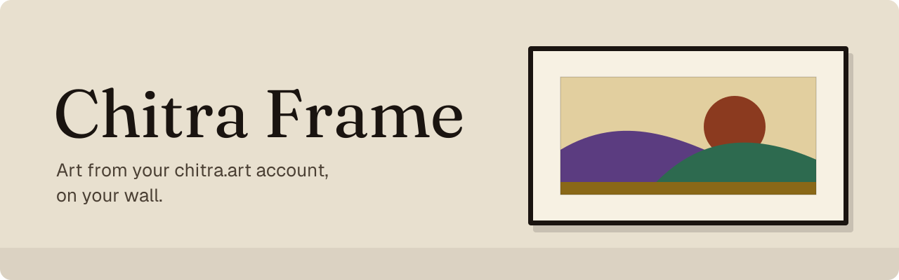

# Chitra Frame

Chitra Frame puts artworks from your [chitra.art](https://chitra.art) account on a Samsung
The Frame. It runs on a server in your home, signs in with a code you confirm on
chitra.art, pairs with the TV once, and then changes the picture on the schedule you choose.

Each work is rendered for the panel before it goes up: cropped or fitted the way you framed
it on chitra.art, turned for a TV that hangs in portrait, with an optional caption naming
the work and the artist. Your own photos can go round a work that leaves room on the screen.
They are read from a folder you choose and never leave your server.

This is an early build. It is tested on a 2026 The Frame Pro; other years should work and
have not been tried.

## What you need

- A Samsung The Frame on the same network as the server
- A chitra.art account
- Unraid, or any Docker host that can run a container with host networking

## Install on Unraid

1. Open a terminal on the server and download the template:

   ```
   wget -O /boot/config/plugins/dockerMan/templates-user/my-chitra-frame.xml \
     https://raw.githubusercontent.com/233-Solutions-Inc/chitra-frame/main/chitra-frame.xml
   ```

2. On the Docker tab choose **Add Container**, then pick **chitra-frame** from the
   Template list.
3. Type a **Setup page password** of at least 8 characters, then **Apply**.
4. Click the container's icon and choose **WebUI**.

## Set it up

The setup page walks through it in order. Unlock it with the password you set, then:

1. **Sign in.** The page shows a code. Open [chitra.art/tv](https://chitra.art/tv) on a
   phone or computer where you are signed in, and enter it. No password is typed into the
   setup page or stored on your server.
2. **Find your TV.** Turn the Frame on and press **Search for my TV**. The first time, the
   TV asks whether to allow the connection: choose **Allow** with its remote.
3. **Say which way it hangs.** The TV cannot tell, so you choose landscape or portrait.
   The test card checks that pictures land the right way up.

A picture goes up as soon as the TV is connected. What plays, how often it changes and the
caption are chosen on chitra.art/tv, under Your Frames.

## Keep the setup page private

The setup page can change what your Frame shows, sign the app in or out, and choose the
folder your photos are read from. Anything that can open its address can try to use it, so:

- **Nothing can be changed without the setup password.** With no password set, the page
  shows status only. Five wrong tries lock that device out for five minutes.
- **Do not put it on the internet.** The page is plain HTTP. Do not forward its port on
  your router or publish it through a reverse proxy.
- **Restrict access as suits your network:** a firewall rule, a separate network for guests
  and smart devices, or a VPN when you are away.
- **Turn it off when you are done.** Use the button at the bottom of the page, or set
  **Setup page** to `off` in the container's settings. No port is open after that, and the
  app keeps playing.

To bring the page back after turning it off from the page, open the container's console,
run `chitra-frame web on`, and restart the container.

## Settings

| Setting | What it is |
|---|---|
| Config (`/config`) | Everything the app keeps: its settings, the sign-in, the TV's pairing and copies of the pictures it sent. Keep it on appdata. |
| My photos (`/photos`) | Optional. A folder of your own photos, mapped read-only. |
| Setup page password | Needed to change anything on the setup page. It is not your chitra.art password. |
| Setup page | `on` or `off`. Off opens no port at all. |
| Setup page port | 8099 unless you change it. |
| TV address | Optional. The Frame's IP address, to skip the network search. |
| Time zone | Optional, for the times in the log, such as `America/Toronto`. |

The container uses host networking. The TV is found with a network search and woken with
Wake-on-LAN, and neither crosses Docker's bridge network.

## Other Docker hosts

```
docker run -d --name chitra-frame \
  --network host \
  --tmpfs /tmp:rw,exec,nosuid,size=512m \
  -v /path/to/config:/config \
  -v /path/to/photos:/photos:ro \
  -e CHITRA_FRAME_WEB_PASSWORD='choose-a-password' \
  -e TZ=America/Toronto \
  --restart unless-stopped \
  ghcr.io/233-solutions-inc/chitra-frame:latest
```

Then open `http://<server>:8099`. Leave out the `/photos` line if you do not want your own
photos shown.

## Updating

On Unraid: Docker tab, **Check for Updates**, then apply the update. Your sign-in, the TV's
pairing and your settings are in `/config` and carry over.

## If something is not working

The container's log says what the app is doing in plain sentences; a line that starts with
`!` is a problem. On Unraid it is under the container's icon, **Logs**.

- **The TV is not found.** Check it is on, and on the same network as the server. If the
  search still misses it, type its address on the setup page.
- **The TV stops answering after a while.** A Frame that is switched off at the wall cannot
  be reached. One that is asleep can: use **Wake the TV** on the setup page.
- **The sign-in code ran out.** Codes last ten minutes. Press **Get a sign-in code** for a
  new one.

For anything else, write to contact@chitra.art.
